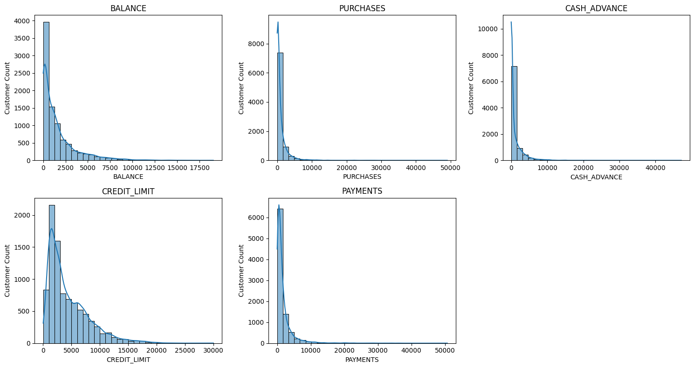
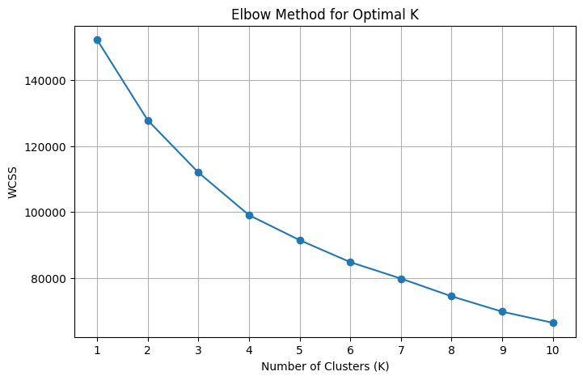
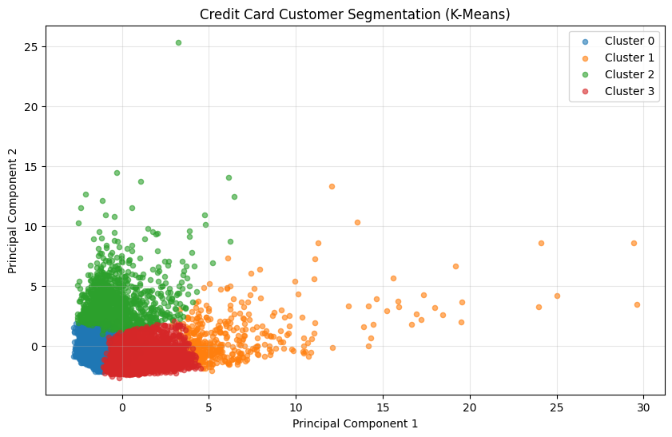
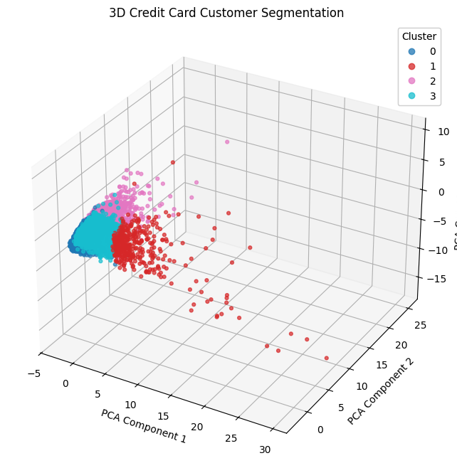
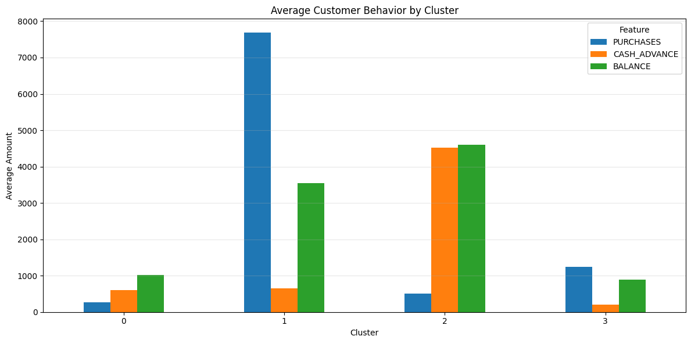
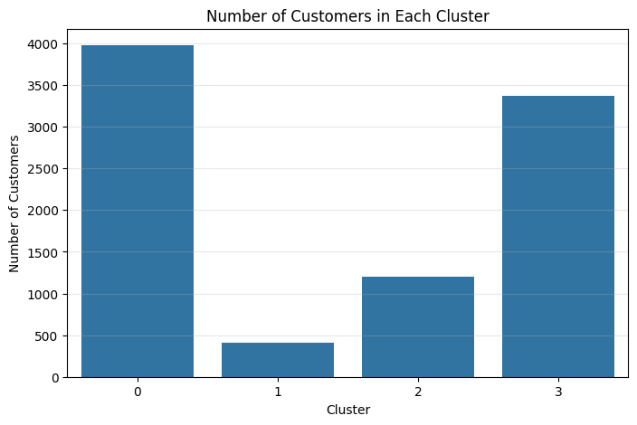
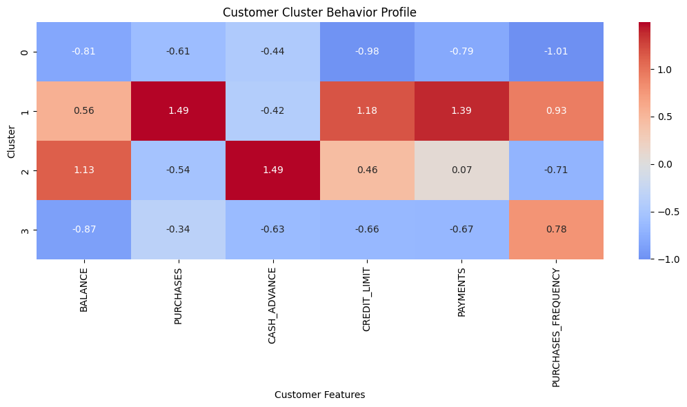

# Credit Card Customer Segmentation

## Project Overview
This project uses unsupervised machine learning to group credit card customers according to their spending and payment behavior.

## Tools and Technologies
- Python
- Pandas and NumPy
- Matplotlib and Seaborn
- Scikit-learn
- Google Colab
- K-Means Clustering
- Principal Component Analysis (PCA)

## Project Workflow
1. Load and inspect the dataset.
2. Handle missing values.
3. Explore customer spending and payment patterns.
4. Standardize numerical features.
5. Use the Elbow Method to help select the number of clusters.
6. Apply the K-Means clustering algorithm.
7. Visualize customer groups using PCA.
8. Evaluate the clustering results.

## Results
The final number of clusters and evaluation scores will be added after verifying the notebook's output.

## Author
**Anjani Kumar**

- GitHub: https://github.com/anjani9091
- Project: https://github.com/anjani9091/Credit-Card-Customer-Segmentation

## Project Visualizations

### 1. Customer Feature Distributions

### 2. Elbow Method

### 3. Customer Clusters — PCA 2D

### 4. Customer Clusters — PCA 3D

### 5. Average Customer Behavior by Cluster

### 6. Customer Count by Cluster

### 7. Customer Cluster Profile

